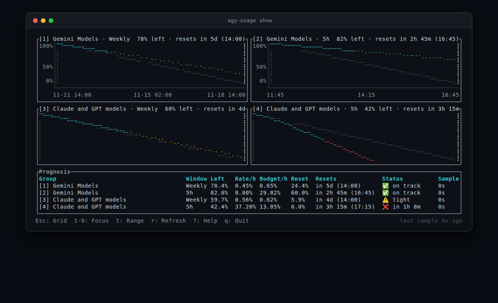
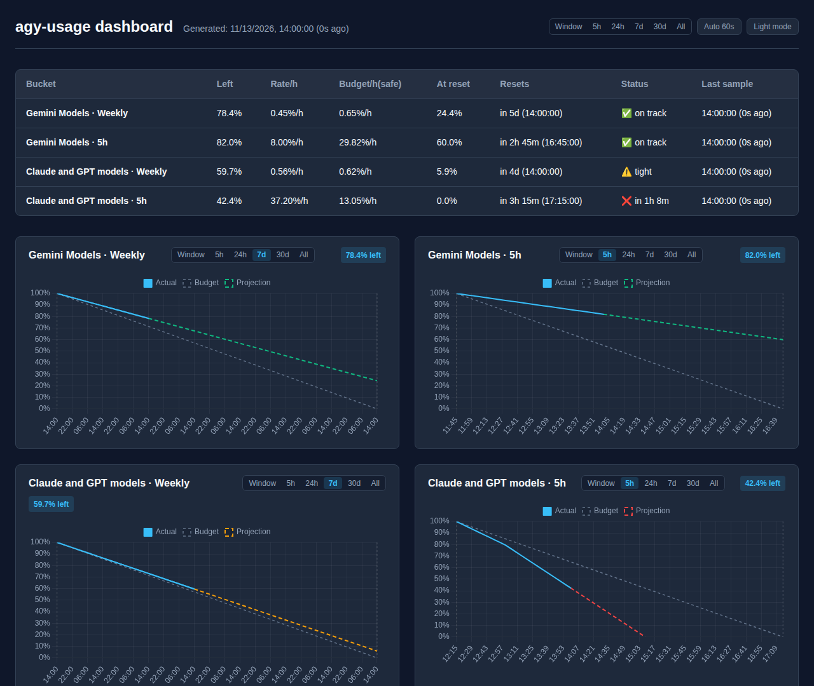

# agy-usage

[](https://github.com/danieljov/agy-usage/actions/workflows/ci.yml)
[](https://crates.io/crates/agy-usage)
[](https://danieljov.github.io/agy-usage)

Quota history, burn-rate prognosis, and interactive TUI/HTML dashboards for Google Antigravity.

`agy-usage` samples your Antigravity quota periodically (every 5 minutes via a `systemd` user timer on Linux or `launchd` user agent on macOS), computes burn rates and quota window projections, and displays the status in both a `ratatui` terminal interface and a self-contained HTML dashboard.

**🔗 [Live Demo](https://danieljov.github.io/agy-usage)** — try the interactive HTML dashboard in your browser (synthetic data).

## Screenshots

### Interactive Terminal Dashboard (`agy-usage show`)



### Self-Contained HTML Dashboard (`agy-usage html --open`)

[](https://danieljov.github.io/agy-usage)

Features **window-aware defaults** (5h charts default to 5h, weekly to 7d), **synchronized hover crosshairs & tooltips** across all charts, and **client-side range toggles** (`5h`, `24h`, `7d`, `30d`, `All`) with automatic reset line decluttering past 48h and 100% offline vendored assets.

The [live demo](https://danieljov.github.io/agy-usage) is rendered from synthetic data and rebuilt every 6 hours (as well as on pushes to `main`) via GitHub Actions (`cargo run --example generate_demo`). Relative timestamps and exhaustion prognoses reflect the state at the last deployment.

## Installation

### Quick Install (Linux & macOS, `x86_64` & `aarch64`)

Install the latest release binary into `~/.local/bin` with automated checksum verification:

```bash
curl -fsSL https://raw.githubusercontent.com/danieljov/agy-usage/main/install.sh | bash
```

### Manual Binary Download (Linux & macOS)

Pre-compiled standalone binaries for Linux (`x86_64-unknown-linux-gnu`, `aarch64-unknown-linux-gnu`) and macOS (`x86_64-apple-darwin`, `aarch64-apple-darwin`) are published on [GitHub Releases](https://github.com/danieljov/agy-usage/releases/latest).

#### Using `curl`
Replace `x86_64-unknown-linux-gnu` with `aarch64-unknown-linux-gnu`, `x86_64-apple-darwin`, or `aarch64-apple-darwin` to match your platform:
```bash
TMP_DIR=$(mktemp -d)
curl -fsSL https://github.com/danieljov/agy-usage/releases/download/v0.5.0/agy-usage-v0.5.0-x86_64-unknown-linux-gnu.tar.gz | tar -xz -C "$TMP_DIR"
mkdir -p ~/.local/bin
mv "$TMP_DIR"/agy-usage-*/agy-usage ~/.local/bin/
rm -rf "$TMP_DIR"
```

#### Using GitHub CLI (`gh`)
```bash
TMP_DIR=$(mktemp -d)
TARGET="x86_64-unknown-linux-gnu" # or aarch64-unknown-linux-gnu, x86_64-apple-darwin, aarch64-apple-darwin
gh release download --repo danieljov/agy-usage --pattern "agy-usage-*-${TARGET}.tar.gz" --dir "$TMP_DIR"
tar -xzf "$TMP_DIR"/*.tar.gz -C "$TMP_DIR"
mkdir -p ~/.local/bin
mv "$TMP_DIR"/agy-usage-*/agy-usage ~/.local/bin/
rm -rf "$TMP_DIR"
```

Ensure `~/.local/bin` is in your `PATH` (e.g., `export PATH="$HOME/.local/bin:$PATH"` in `~/.bashrc` or `~/.zshrc`). Verify the installation:
```bash
agy-usage --help
```

### From Source (Cargo)

Ensure Rust 1.88+ is installed:

```bash
# From crates.io
cargo install agy-usage

# From git repository
cargo install --git https://github.com/danieljov/agy-usage.git

# Or build and install from a local clone
cargo install --path .
```

### Shell Completions

Generate tab-completion scripts for `bash`, `zsh`, `fish`, `elvish`, or `powershell`:

```bash
# Bash
mkdir -p ~/.local/share/bash-completion/completions
agy-usage completions bash > ~/.local/share/bash-completion/completions/agy-usage

# Zsh (ensure ~/.zfunc is in your fpath before compinit)
mkdir -p ~/.zfunc
agy-usage completions zsh > ~/.zfunc/_agy-usage

# Fish
mkdir -p ~/.config/fish/completions
agy-usage completions fish > ~/.config/fish/completions/agy-usage.fish
```

## Quick Start

1. **Install automated sampling timer:**
   ```bash
   agy-usage install-timer
   ```
   This sets up a background collector running every 5 minutes (`~/.config/systemd/user/agy-usage.{service,timer}` on Linux, or `~/Library/LaunchAgents/com.agy-usage.collect.plist` on macOS). Pass `--interval <MINUTES>` (any divisor of 60: `1, 2, 3, 4, 5, 6, 10, 12, 15, 20, 30, 60`) to customize cadence.

2. **Sample quota immediately:**
   ```bash
   agy-usage collect
   ```

3. **View in interactive terminal dashboard:**
   ```bash
   agy-usage show
   ```
   Or print a single frame (falls back to plain text when redirected or non-TTY):
   ```bash
   agy-usage show --once
   ```

4. **View HTML dashboard in your browser:**
   ```bash
   agy-usage html --open
   ```

5. **Scriptable status & diagnostics:**
   ```bash
   agy-usage status --format waybar
   agy-usage doctor
   ```

## TUI Controls

- `r`: Collect fresh samples now, refresh view, and update `dashboard.html`
- `o`: Render and open `dashboard.html` in your default browser
- `t` (or `w`) / `T` (or `W`): Cycle chart time range forward / backward (`Window` → `24h` → `7d` → `30d` → `All`)
- `1`–`9` / `j`/`k` / `↑`/`↓` / `Tab`/`BackTab`: Focus a bucket full-screen or cycle focus
- `Esc` / `0`: Close help overlay or return to 2-column grid view
- `?`: Toggle help overlay (controls & status legend)
- `q` or `Ctrl-C`: Quit

## CLI Reference

```text
Usage: agy-usage [OPTIONS] <COMMAND>

Commands:
  collect          Collect quota samples from agy and update dashboard
  show             Show terminal dashboard
  status           Print compact read-only quota status (ideal for Waybar, tmux, and scripts)
  doctor           Run read-only diagnostics on binary, storage, timer, and clock configuration
  html             Generate HTML dashboard
  install-timer    Install background collection timer (systemd on Linux, launchd on macOS) [supports --interval <MINUTES>]
  uninstall-timer  Uninstall background collection timer
  completions      Generate shell completion scripts
  help             Print this message or the help of the given subcommand(s)

Options:
      --data-dir <DATA_DIR>                Data directory [default: $XDG_DATA_HOME/agy-usage or ~/.local/share/agy-usage]
      --tight-threshold <TIGHT_THRESHOLD>  Tight threshold fraction [default: 0.10]
      --history-days <HISTORY_DAYS>        Days of history to include in HTML dashboard [default: 30]
      --retention-days <RETENTION_DAYS>    Days of raw samples to keep on disk [default: max(90, --history-days)]
      --clock <CLOCK>                      Clock format for displayed times [default: auto] [possible values: auto, 12h, 24h]
  -h, --help                               Print help
  -V, --version                            Print version
```

### Status Integrations (`status` & `doctor`)

- `agy-usage status` reads local `samples.jsonl` without invoking `agy`:
  - `agy-usage status --format oneline`: single-line summary for terminals and prompts
  - `agy-usage status --format tmux`: compact status string safe for `status-right`
  - `agy-usage status --format waybar`: Waybar `custom/` JSON (`text`, `tooltip`, `class`, `percentage`)
  - `agy-usage status --json`: full structured JSON (`schema_version: 1`)
- `agy-usage doctor [--json]`: read-only health check inspecting `agy` resolution, data directory, `samples.jsonl`, `dashboard.html`, timer units, and clock detection.

## Time Format

Displayed times (TUI header, HTML dashboard header, table, chart axes and tooltips) use your local time zone and your system's 12h/24h clock setting. With `--clock auto` (the default):
- **Linux:** On GNOME-family desktops (`XDG_CURRENT_DESKTOP` unset or GNOME/Ubuntu/Cinnamon/etc.), reads `gsettings get org.gnome.desktop.interface clock-format`, falling back to `LC_TIME` and then 24h. Explicit non-GNOME desktops (KDE, XFCE, Sway, Hyprland, …) skip `gsettings` and consult `LC_TIME` directly.
- **macOS:** Checks `defaults read -g` (`AppleICUForce24HourTime`, `AppleICUForce12HourTime`, `AppleLocale`) before falling back to `LC_TIME` and 24h.

Pass `--clock 12h` or `--clock 24h` to override at any time.

## Data Retention & Pruning

- **Retention Window:** By default, raw 5-minute samples are retained on disk for `max(90, --history-days)` days. You can customize this with `--retention-days <N>` (minimum 8 days; must be $\ge$ `--history-days`).
- **Bounded Loading:** `collect`, `html`, `status`, and `show --once` keep only samples from the last `--history-days` (`status` fixes this to `0`) plus an 8-day margin (one weekly window and a day of slack) in memory, so their memory use and analysis cost do not grow with `--retention-days` (older lines are still read, but only their timestamp is parsed). Known windows up to 7 days (`weekly`, `daily`, and `<N>h`/`<N>d`/`<N>w` up to 7d) use a rate lookback of `window_length / 5` clamped between 15 minutes and 24 hours (24h for weekly, 1h for 5h); buckets without a complete rate lookback inside that range are left out. Buckets with a window of unknown length (or longer than 7 days) are reported if sampled in that range, and then the full history is analyzed so their prognosis stays exact; stale buckets are omitted either way. The interactive `show` TUI always loads the full retained history for its `All` range, so it can still list long-idle buckets that these commands omit.
- **Atomic Lazy Pruning:** During collection, `agy-usage` checks if the oldest sample exceeds the retention threshold plus a 1-day buffer, performing at most one atomic rewrite per day. File mutations and rewrites coordinate via a sidecar lock (`samples.lock`) to ensure zero lost writes during concurrent appends.
- **Offline HTML:** Generated HTML dashboards vendor Chart.js and date adapters locally with zero external network requests.
- **Timer Propagation:** Re-running `agy-usage --retention-days <N> install-timer` automatically propagates configured threshold, history, and retention settings into the systemd user service unit (or macOS `launchd` user agent). An explicit `--clock 12h|24h` is propagated too; `auto` is left out so the timer keeps following the system setting.

## Releasing & Crates.io Publishing

Before tagging a release:
1. Update the version in `Cargo.toml` (`cargo check` to update `Cargo.lock`), add the `## [x.y.z] - YYYY-MM-DD` section and comparison link in `CHANGELOG.md`, and update the release download URL in `README.md`.
2. Regenerate the release screenshots (`assets/screenshots/dashboard.png` and `assets/screenshots/tui.png`) so their embedded `Software` metadata matches the new release version and date (enforced by `cargo test`):
   ```bash
   cargo run --example generate_screenshots
   ```

Pushing a version tag (`v*` matching `Cargo.toml`) triggers `.github/workflows/release.yml`, which verifies formatting, lints, tests, and tag-version alignment, uploads the Linux and macOS (`x86_64` and `aarch64`) binary tarballs to GitHub Releases, and idempotently publishes the crate to crates.io.

Authentication with crates.io supports two setups:
1. **Crates.io Trusted Publishing (Recommended):** Configure `danieljov/agy-usage` (workflow `release.yml`) as a Trusted Publisher in your crate settings on crates.io (uses GitHub OIDC `id-token: write` via `rust-lang/crates-io-auth-action@v1`).
2. **Repository Secret Fallback:** Add a crates.io API token as `CARGO_REGISTRY_TOKEN` under GitHub repository `Settings → Secrets and variables → Actions`.

## License

MIT

