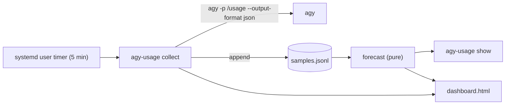

# agy-usage — Antigravity quota history, graphs & prognosis

Date: 2026-10-11
Status: Approved (revised after plan review)
Repository: https://github.com/danieljov/agy-usage (MIT, default branch `main`)

## 1. Intent

**Goal (user-stated):** See Antigravity quota usage over time, as graphs, for the
weekly limit and the five-hour limit, for each model group, including a prognosis.

**Agreed decisions:**

| Topic | Decision |
|---|---|
| History | Start collecting now; no backfill from conversation logs |
| Views | Interactive terminal dashboard **and** self-contained HTML dashboard |
| Prognosis | Burn-rate projection to reset **plus** an even-pace budget line and safe rate |
| Language | Rust (single binary), ratatui for the TUI |

**Assumptions:** Linux with systemd user services; `agy` on `PATH` and logged in;
a C linker (`cc`) is available for building.

**Success criteria:**
1. A systemd user timer stores a sample of every quota bucket every 5 minutes.
2. `agy-usage show` displays 4 charts (Gemini / Claude+GPT × Weekly / 5h) with
   actual, budget and projection series, plus a prognosis table.
3. `agy-usage html` produces one HTML file showing the same charts and table.
4. Prognosis reports, per bucket: projected % at reset, projected empty time (if
   before reset), current rate, safe rate, and a status (✅ / ⚠️ / ❌).

## 2. Data source

`agy -p "/usage" --output-format json` (does not spend quota). Only the structured
part is used:

```
command.data.groups[]            name: "Gemini Models" | "Claude and GPT models"
  .buckets[]                     id: "gemini-weekly" | "gemini-5h" | "3p-weekly" | "3p-5h"
    .window                      "weekly" | "5h"
    .remaining_fraction          float 0..1   (absent/disabled → bucket skipped)
    .reset_time                  RFC 3339 UTC
```

Group and bucket names are read from the JSON, never hard-coded, so new groups
appear automatically. Window lengths: `weekly` = 7 days, `5h` = 5 hours. An
unknown `window` value is stored but has no budget line.

## 3. Architecture

One crate at the root of https://github.com/danieljov/agy-usage producing one binary `agy-usage`.



| Module | Responsibility | Depends on |
|---|---|---|
| `source` | Run `agy`, parse JSON → `Vec<Sample>` | `serde_json`, `std::process` |
| `store` | Append/read JSONL | `serde_json` |
| `forecast` | Windows, burn rate, budget, prognosis — no I/O | `chrono` |
| `tui` | ratatui dashboard, `--once` static frame | `ratatui`, `crossterm` |
| `html` | Render self-contained HTML | `serde_json` |
| `timer` | Write/remove systemd units | `std::fs`, `systemctl` |
| `main` | `clap` CLI wiring | all |

### 3.1 Sample record (one JSONL line per bucket per collection)

```json
{"ts":"2026-10-11T17:20:00Z","group":"Claude and GPT models","bucket_id":"3p-weekly",
 "window":"weekly","remaining":0.6094,"reset_time":"2026-10-16T20:52:27Z"}
```

All timestamps stored in UTC; rendered in local time.

### 3.2 CLI

| Command | Behaviour |
|---|---|
| `collect [--no-html]` | Fetch, append samples, regenerate HTML (unless `--no-html`) |
| `show [--once]` | Interactive TUI; `--once` prints one frame and exits |
| `html [--open] [--out PATH]` | Write dashboard; optionally open with `xdg-open` |
| `install-timer` / `uninstall-timer` | Manage `~/.config/systemd/user/agy-usage.{service,timer}` |

Global flags: `--data-dir` (default `$XDG_DATA_HOME/agy-usage` →
`~/.local/share/agy-usage`), `--tight-threshold` (default `0.10`),
`--history-days` (HTML history, default `30`).

TUI keys: `r` collect now and refresh, `1`–`9` focus one bucket full-screen,
`Esc` back to grid, `q` quit. Layout: 2-column grid when terminal ≥ 100 cols,
otherwise stacked; prognosis table below. `show --once` falls back to plain
text when stdout is not a terminal.

## 4. Forecast model

Per bucket (`group` + `bucket_id`), samples sorted by `ts`.

**Window detection.** A new window starts at sample *i* when either
- `reset_time[i]` > `reset_time[i-1]` + 60 s **and** `reset_time[i-1]` ≤ `ts[i]`
  (previous window expired; an idle bucket at 100 % reports a sliding
  `reset_time = now + window`, which must not start new windows), or
- `remaining[i]` > `remaining[i-1]` + 0.005 (quota went up).

The current window is the samples since the last boundary **with `ts ≥ start`**
(drops idle pre-window samples).

**Anchor.** "now" below means the latest sample's `ts`, which keeps the forecast
deterministic. If `reset_time` ≤ anchor (stale data), the forecast is
`Collecting` and the UI shows the sample age.

**Window start / end.** `end = reset_time` (latest sample).
`start = end − window_length`.

**Units.** Stored and computed as fractions (0..1) and fraction/hour; the UI
displays them as % and %/h.

**Budget line.** Linear from 100 % at `start` to 0 % at `end`.
`budget_now = (end − now) / window_length`.
`safe_rate = remaining_now / hours_until_reset`.

**Burn rate.** Least-squares slope of `remaining` over `ts` for current-window
samples within the lookback (weekly: 24 h, 5h: 1 h). `rate = max(0, −slope)`.
Requires ≥ 2 samples spanning ≥ 15 min; otherwise status `Collecting`.

**Projection.** From (`now`, `remaining_now`) with slope `−rate`:
- `at_reset = max(0, remaining_now − rate × hours_until_reset)`
- `empty_at = now + remaining_now / rate` if `rate > 0` and before `end`

**Status.**
| Condition | Status |
|---|---|
| insufficient data | ⏳ Collecting |
| `empty_at` before reset | ❌ Will run out |
| `at_reset < tight_threshold` | ⚠️ Tight |
| otherwise | ✅ On track |

**Output struct** `Prognosis { remaining_now, reset_time, last_sample,
budget_now, rate_per_h, safe_rate_per_h, at_reset, empty_at, status }` — all
derived numbers are `Option` (None when stale/unknown window/insufficient data).
Group, bucket and window live on the enclosing `BucketReport`.

Charts plot, for the current window: actual samples (line), budget (line from
`start` to `end`), projection (from last sample to `empty_at` or `end`), and a
vertical reset marker. The TUI's x-range is the current window; the HTML shows
the last 30 days of history (`--history-days`) with window boundaries drawn as
light vertical lines.

## 5. Error handling

| Case | Behaviour |
|---|---|
| `agy` missing / non-zero exit / not logged in / bad JSON | `collect` exits non-zero with message on stderr; nothing written |
| Bucket disabled or missing `remaining_fraction` | Skipped |
| All buckets disabled (0 samples) | `collect` exits non-zero; nothing written |
| Corrupt JSONL line | Skipped with warning; rest loads |
| Concurrent collects | Each sample batch written with one `write` on an `O_APPEND` file; `dashboard.html` written via temp file + rename |
| No samples at all | TUI/HTML show an empty-state message with the `install-timer` hint |
| Data dir missing | Created on first `collect` |
| Missed timer runs (suspend/off) | Timer uses `OnCalendar` + `Persistent=true` to catch up |

## 6. Testing

TDD; `cargo test`, `cargo clippy --all-targets -- -D warnings`, `cargo fmt --check` must pass.

- `forecast`: constant burn; idle; mid-series reset; run-out before reset; single
  sample; < 15 min span; tight/on-track threshold boundary; quota increase;
  sliding idle reset; idle-then-usage; stale data; unknown window.
- `source`: parse fixture of real `/usage` JSON (`tests/fixtures/usage.json`);
  disabled bucket; malformed JSON.
- `store`: round-trip; corrupt line skipped; append preserves existing lines.
- `html`: embedded data for all reports; `</script>` escaping; history cap; no-data state.
- `tui`: render via ratatui `TestBackend` contains bucket titles and table; tiny
  terminal; >4 buckets; plain-text fallback.
- `timer`: generated unit file contents (no `systemctl` call in tests).
- CLI: `collect` end-to-end with a fake `agy` script.

## 7. Out of scope

Backfilling from conversation logs, pattern-based forecasting, notifications,
web server, config file, non-Linux schedulers.
