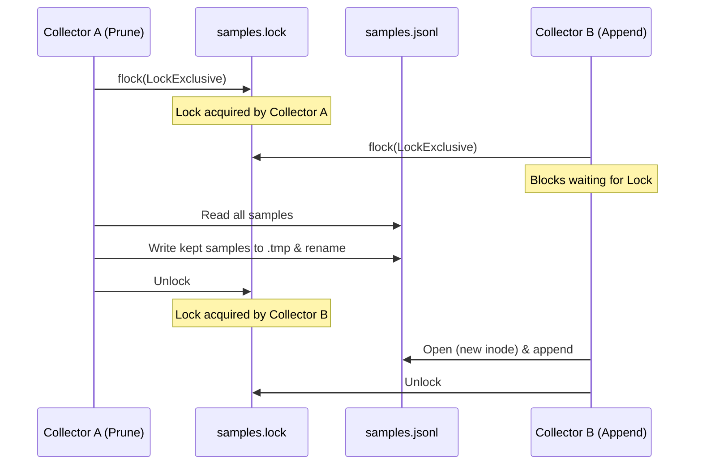

# Phase 3: Long-Term Scalability & Offline Resilience Design Spec

**Date**: 2026-10-11  
**Status**: Draft for User Review  
**Branch**: `feat/agy-usage`  
**Targets**: [`agy-usage`](https://github.com/danieljov/agy-usage)  

---

## 1. Intent & Scope

Phase 3 addresses long-term storage scalability and zero-network operational resilience identified in `system_reviews.md`:
1. **Sliding Retention Window**: Cap `samples.jsonl` size by pruning samples older than `--retention-days` (default 90 days), avoiding unbounded $O(N)$ growth.
2. **Atomic Sidecar Lock Protocol**: Synchronize appends, prunes, and reads using an advisory lock on `samples.lock` to prevent lost writes and race conditions during file rewrites.
3. **Lazy Pruning Trigger**: Check the oldest sample on each `collect`; rewrite the file only when the oldest record exceeds retention by at least 1 day (~once per day rewrite frequency).
4. **CLI Validation & Timer Propagation**: Keep retention distinct from display history (`--history-days`), enforce `--retention-days >= --history-days` and `--retention-days >= 8`, and propagate into systemd service units.
5. **Incremental Store Reader**: Enable the TUI to read only newly appended bytes $O(\Delta)$ since its last read offset, with automatic recovery upon compaction or truncation.
6. **Vendored Chart.js**: Bundle minified Chart.js and date adapter directly into the binary via `include_str!`, eliminating external CDN script dependencies for 100% offline self-contained HTML dashboards.

---

## 2. Storage & Concurrency Architecture

### 2.1 Sidecar Lock Protocol (`samples.lock`)
Currently, `store::append` and `store::load` lock `samples.jsonl` directly. When pruning rewrites `samples.jsonl` via atomic rename (`tempfile` + `rename`), concurrent appenders holding the old file handle or opening before rename can write to an unlinked inode, losing samples.

To guarantee zero lost writes:
- All storage operations synchronize on a sidecar lock file: `samples.lock` in the same directory (`path.with_extension("lock")`).
- **Append**: Exclusive flock on `samples.lock`. Opens `samples.jsonl` with `create(true).append(true)`, writes batch, unlocks.
- **Prune**: Exclusive flock on `samples.lock`. Reads `samples.jsonl`, writes kept records (`ts >= cutoff`) to a temporary file in the same directory, calls `sync_all()`, renames temporary file over `samples.jsonl`, unlocks.
- **Load / Incremental Load**: Shared flock on `samples.lock`. Multiple readers execute concurrently without blocking each other.



### 2.2 Lazy Prune Trigger
Rewriting `samples.jsonl` on every 5-minute `collect` would cause unnecessary disk I/O.
- Peeking function: `store::oldest_timestamp(path)` opens `samples.jsonl` with shared lock, reads only the first non-empty valid JSON line, extracts `ts`, and returns immediately (<10 µs).
- In `collect`:
  ```rust
  let prune_threshold = Utc::now() - Duration::days(i64::from(retention_days) + 1);
  if let Ok(Some(oldest)) = store::oldest_timestamp(&samples_path)
      && oldest <= prune_threshold
  {
      let cutoff = Utc::now() - Duration::days(i64::from(retention_days));
      let _ = store::prune(&samples_path, cutoff);
  }
  ```
- This triggers a prune approximately once every 24 hours.

### 2.3 Incremental Store Reader for TUI
- Signature:
  ```rust
  pub fn load_from(path: &Path, offset: u64) -> std::io::Result<(Loaded, u64)>
  ```
- **Truncation / Compaction Recovery**:
  If the file metadata indicates `file_len < offset`, the file has been pruned or truncated. The reader resets `offset = 0` and performs a full reload.
- **Incremental Read**:
  The reader seeks to `offset`, parses new lines with `read_until(b'\n', ...)`, and returns the parsed samples along with the new byte offset (`file.stream_position()?`).
- In `src/tui.rs`:
  The main loop stores `last_offset: u64` and `accumulated_samples: Vec<Sample>`.
  When `load_from` returns:
  - If new offset < `last_offset`: reset `accumulated_samples = new_samples`.
  - Else: `accumulated_samples.extend(new_samples)`.
  - Forecast analysis executes against `accumulated_samples`.

---

## 3. CLI & Timer Configuration

### 3.1 CLI Arguments
Add `--retention-days` to the top-level CLI:
```rust
#[arg(
    long,
    default_value = "90",
    value_parser = clap::value_parser!(u32).range(8..=36500),
    help = "Number of days of raw samples to retain before pruning (min 8)"
)]
pub retention_days: u32,
```

### 3.2 Validation Rules
In `src/main.rs`:
1. `--retention-days >= 8` (enforced by clap value parser; covers 7-day weekly window + 24-hour lookback).
2. `cli.retention_days >= cli.history_days`:
   If `cli.retention_days < cli.history_days`:
   Exit non-zero with error:
   `Error: --retention-days (<R>) cannot be less than --history-days (<H>)`

### 3.3 Systemd Propagation
In `src/timer.rs`:
- Pass `retention_days: u32` to `unit_files`.
- Include `--retention-days <N>` in the generated `ExecStart=` directive of `agy-usage.service`.

---

## 4. Vendored Offline Chart.js Architecture

### 4.1 Asset Placement
Download and commit minified production bundles into `assets/vendor/`:
- `assets/vendor/chart.umd.min.js` (~208 KB)
- `assets/vendor/chartjs-adapter-date-fns.bundle.min.js` (~50 KB)

### 4.2 Inlining & Template Rendering
- In `src/html.rs`:
  ```rust
  const CHART_JS: &str = include_str!("../assets/vendor/chart.umd.min.js");
  const DATE_FNS_ADAPTER: &str = include_str!("../assets/vendor/chartjs-adapter-date-fns.bundle.min.js");
  ```
- In `assets/dashboard.html`:
  Replace CDN script tags:
  ```html
  <script src="https://cdn.jsdelivr.net/npm/chart.js@4"></script>
  <script src="https://cdn.jsdelivr.net/npm/chartjs-adapter-date-fns@3"></script>
  ```
  with inlined script injection placeholders:
  ```html
  <script>/*__CHART_JS__*/</script>
  <script>/*__DATE_FNS_ADAPTER__*/</script>
  ```
- In `html::render`:
  Substitute `/*__CHART_JS__*/` and `/*__DATE_FNS_ADAPTER__*/` with the bundled scripts.
- Guarantees 100% offline rendering, zero external CDN requests, and full supply-chain independence (resolving SEC-03).

---

## 5. Verification & Testing Plan

### 5.1 Storage & Concurrency Tests (`src/store.rs`)
- `prune_filters_old_records_atomically`:
  Write samples spanning 120 days. Prune with cutoff at 90 days. Verify records `< cutoff` are removed, records `>= cutoff` are preserved, and invalid lines are skipped.
- `prune_concurrent_with_append_no_lost_writes`:
  Spawn 10 concurrent threads appending batches while a prune thread runs concurrently. Verify zero data corruption and that all appended samples are present.
- `load_from_incremental_and_truncation_recovery`:
  Read offset 0. Append 2 samples. Read from offset 1. Verify only new samples returned. Truncate/rewrite file to smaller size, verify reader resets and recovers cleanly.
- `oldest_timestamp_reads_first_line`:
  Verify peeking line 1 extracts the correct timestamp without scanning the full file.

### 5.2 Timer Tests (`src/timer.rs`)
- `unit_files_propagates_retention_days`:
  Verify `--retention-days` is present in generated `ExecStart=` directive.

### 5.3 CLI Integration Tests (`tests/cli.rs`)
- Reject `--retention-days < 8` and `--retention-days < history_days`.
- End-to-end `collect` with old fixture verifies lazy pruning triggers.

### 5.4 HTML Tests (`src/html.rs`)
- Verify rendered HTML contains bundled Chart.js source and zero external `cdn.jsdelivr.net` script tags.

---

## 6. Implementation Stages (Post-Approval)

1. **Stage 1**: Vendor Chart.js & date-fns adapter into `assets/vendor/` and update `html.rs` / `assets/dashboard.html`.
2. **Stage 2**: Implement sidecar lock `samples.lock`, `store::prune`, `store::oldest_timestamp`, and `store::load_from` in `src/store.rs`.
3. **Stage 3**: Wire incremental store reading in `src/tui.rs`.
4. **Stage 4**: Add `--retention-days` CLI flag, validation, and timer propagation in `src/main.rs` and `src/timer.rs`.
5. **Stage 5**: Add comprehensive test suites, run Pass 1 and Pass 2 local reviews, and verify green CI.
