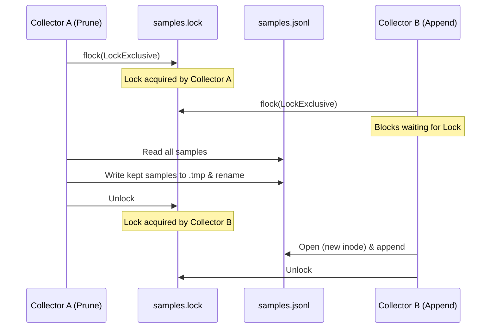

# Phase 3: Long-Term Scalability & Offline Resilience Design Spec

**Date**: 2026-10-11  
**Status**: Draft for User Review  
**Branch**: `feat/agy-usage`  
**Targets**: [`agy-usage`](https://github.com/danieljov/agy-usage)  

---

## 1. Intent & Scope

Phase 3 addresses long-term storage scalability and zero-network operational resilience identified in `system_reviews.md`:
1. **Sliding Retention Window**: Cap `samples.jsonl` size by pruning samples older than `--retention-days` (default `max(90, --history-days)` days), avoiding unbounded $O(N)$ growth.
2. **Atomic Sidecar Lock Protocol**: Synchronize appends, prunes, and reads using an advisory lock on `samples.lock` to prevent lost writes and race conditions during file rewrites.
3. **Lazy Pruning Trigger**: Check the oldest sample on each `collect`; rewrite the file only when the oldest record exceeds retention by at least 1 day (~once per day rewrite frequency).
4. **CLI Validation & Timer Propagation**: Keep retention distinct from display history (`--history-days`), enforce `--retention-days >= --history-days` and `--retention-days >= 8`, and propagate into systemd service units.
5. **Incremental Store Reader**: Enable the TUI to read only newly appended bytes $O(\Delta)$ since its last read offset, with automatic recovery upon compaction or truncation.
6. **Vendored Chart.js**: Bundle minified Chart.js and date adapter directly into the binary via `include_str!`, eliminating external CDN script dependencies for 100% offline self-contained HTML dashboards.

---

## 2. Storage & Concurrency Architecture

### 2.1 Sidecar Lock Protocol (`samples.lock`)
Currently, `store::append` and `store::load` lock `samples.jsonl` directly. When pruning rewrites `samples.jsonl` via atomic rename (`tempfile` + `rename`), concurrent appenders holding the old file handle or opening before rename can write to an unlinked inode, losing samples.

To guarantee zero lost writes:
- All storage operations synchronize on a sidecar lock file: `samples.lock` in the same directory (`path.with_extension("lock")`).
- **Lock ordering (mandatory)**: the sidecar lock is always acquired *before* `samples.jsonl` is opened and released only after the write/rename completes. Opening first and locking second would let an appender hold the pre-rename inode.
- **Append**: Exclusive flock on `samples.lock`. Then opens `samples.jsonl` with `create(true).append(true)`, writes batch, closes, unlocks. The data file itself is no longer flocked.
- **Prune**: Exclusive flock on `samples.lock`, held across the whole read → write → rename. Reads `samples.jsonl`, drops corrupt lines, writes kept records (`ts >= cutoff`) to a temporary file in the same directory, copies the original file permissions, calls `sync_all()`, renames temporary file over `samples.jsonl`, best-effort fsyncs the directory, unlocks. A missing file is a no-op.
- **Load / Incremental Load**: Shared flock on `samples.lock`. Multiple readers execute concurrently without blocking each other. A missing `samples.jsonl` returns empty before touching the sidecar.



### 2.2 Lazy Prune Trigger
Rewriting `samples.jsonl` on every 5-minute `collect` would cause unnecessary disk I/O.
- Peeking function: `store::oldest_timestamp(path)` opens `samples.jsonl` with shared lock, reads only the first non-empty valid JSON line, extracts `ts`, and returns immediately (<10 µs).
- In `collect`, directly after `store::append` and before HTML generation (so it also runs with `--no-html`), using the effective `retention_days` and the collection `now`:
  ```rust
  let retention = Duration::days(i64::from(retention_days));
  match store::oldest_timestamp(&samples_path) {
      Ok(Some(oldest)) if oldest <= now - retention - Duration::days(1) => {
          if let Err(e) = store::prune(&samples_path, now - retention) {
              eprintln!("warning: failed to prune {}: {e}", samples_path.display());
          }
      }
      Ok(_) => {}
      Err(e) => eprintln!("warning: failed to inspect {}: {e}", samples_path.display()),
  }
  ```
- This triggers a prune approximately once every 24 hours.

### 2.3 Incremental Store Reader for TUI
- Signature:
  ```rust
  #[derive(Debug, Clone, Copy, PartialEq, Eq, Default)]
  pub struct Cursor { pub ino: u64, pub offset: u64 }

  pub struct Incremental { pub loaded: Loaded, pub cursor: Cursor, pub reset: bool }

  pub fn load_from(path: &Path, cursor: Cursor) -> std::io::Result<Incremental>
  ```
- **Replacement / Truncation Recovery**:
  Prune replaces the file via rename, so the new file may already be *larger* than the old offset by the time the TUI reloads; a length check alone is insufficient. The reader resets (`start = 0`, `reset = true`) when `metadata.ino() != cursor.ino` (file replaced) **or** `metadata.len() < cursor.offset` (in-place truncation). A missing file returns empty with `Cursor::default()` and `reset = true` if the input cursor was non-default.
- **Incremental Read**:
  The reader seeks to `start` and parses lines with `read_until(b'\n', ...)`. Only `\n`-terminated lines are consumed; a trailing partial line is neither parsed nor skipped and is re-read on the next call. The returned cursor is `{ ino, offset: start + consumed_bytes }`.
- Residual edge case: inode reuse across two prunes between reloads could defeat detection; accepted because prunes run at most daily and the TUI reloads every 30 s.
- In `src/tui.rs`:
  The main loop stores `cursor: Cursor` and `accumulated_samples: Vec<Sample>`.
  When `load_from` returns:
  - If `reset`: `accumulated_samples = new_samples`.
  - Else if no new samples: keep existing reports (skip re-analysis).
  - Else: `accumulated_samples.extend(new_samples)`.
  - Forecast analysis executes against `accumulated_samples`.

---

## 3. CLI & Timer Configuration

### 3.1 CLI Arguments
Add `--retention-days` to the top-level CLI:
```rust
/// Days of raw samples to keep on disk [default: max(90, --history-days)]
#[arg(long, global = true, value_parser = clap::value_parser!(u32).range(8..=36500))]
pub retention_days: Option<u32>,
```

### 3.2 Validation Rules
In `src/main.rs`, before dispatching any command:
1. `--retention-days >= 8` (enforced by clap value parser; covers 7-day weekly window + 24-hour lookback).
2. Effective retention = explicit value, or `max(90, history_days)` when omitted.
3. If `--retention-days` is **explicitly** given and `< history_days`:
   Exit non-zero with error:
   `Error: --retention-days (<R>) cannot be less than --history-days (<H>)`
4. Omitting `--retention-days` never fails. This is required for upgrade compatibility: units installed before this phase run `--history-days <H> collect` with no retention flag, and a hard `90` default would make every timer run fail for `H > 90`.

### 3.3 Systemd Propagation
In `src/timer.rs`:
- Pass the effective `retention_days: u32` to `unit_files` and `install` (new last parameter).
- Include `--retention-days <N>` in the generated `ExecStart=` directive of `agy-usage.service`, after `--history-days`.

---

## 4. Vendored Offline Chart.js Architecture

### 4.1 Asset Placement
Download (with `curl -fsSL`, so HTTP errors fail loudly) and commit minified production bundles at **exact pinned versions** (latest `chart.js@4.x` and `chartjs-adapter-date-fns@3.x` at implementation time) into `assets/vendor/`:
- `assets/vendor/chart.umd.min.js` (~208 KB)
- `assets/vendor/chartjs-adapter-date-fns.bundle.min.js` (~50 KB)
- `assets/vendor/README.md`: exact versions, source URLs, SHA-256 of each bundle.
- `assets/vendor/LICENSE-chartjs`, `assets/vendor/LICENSE-chartjs-adapter-date-fns`: MIT license notices.

### 4.2 Inlining & Template Rendering
- In `src/html.rs`:
  ```rust
  const CHART_JS: &str = include_str!("../assets/vendor/chart.umd.min.js");
  const DATE_FNS_ADAPTER: &str = include_str!("../assets/vendor/chartjs-adapter-date-fns.bundle.min.js");
  ```
- In `assets/dashboard.html`:
  Replace CDN script tags:
  ```html
  <script src="https://cdn.jsdelivr.net/npm/chart.js@4"></script>
  <script src="https://cdn.jsdelivr.net/npm/chartjs-adapter-date-fns@3"></script>
  ```
  with inlined script injection placeholders:
  ```html
  <script>/*__CHART_JS__*/</script>
  <script>/*__DATE_FNS_ADAPTER__*/</script>
  ```
- In `html::render`:
  Substitute `/*__CHART_JS__*/` and `/*__DATE_FNS_ADAPTER__*/` with the bundled scripts **before** substituting `/*__AGY_DATA__*/null`. The data JSON only escapes `<`, so substituting data first would let a group/bucket name containing a vendor placeholder expand into a full bundle.
- Vendored bundles must not contain `</script` (case-insensitive); enforced by a unit test.
- Guarantees 100% offline rendering, zero external CDN requests, and full supply-chain independence (resolving SEC-03).

---

## 5. Verification & Testing Plan

### 5.1 Storage & Concurrency Tests (`src/store.rs`)
- `prune_filters_old_records_and_skips_corrupt_lines`:
  Mix old, boundary (`ts == cutoff`), new, and corrupt lines. Verify records `< cutoff` are removed, records `>= cutoff` are preserved, corrupt lines are dropped, the return value counts only removed valid samples, and file permissions are preserved.
- `prune_missing_file_is_noop`.
- `prune_concurrent_with_append_no_lost_writes`:
  50 iterations; a `Barrier` releases 1 prune thread and 10 append threads simultaneously. Appended samples are dated after the cutoff and the seed sample before it, so the result is deterministic: exactly the 10 appended samples remain, `skipped == 0`.
- `load_from_incremental`: default cursor → reset + full read; subsequent calls return only new samples; no-change call returns empty with an unchanged cursor.
- `load_from_resets_after_prune_rename_even_if_file_grew`: prune via rename, then append until the new file exceeds the old offset; verify `reset` and full surviving contents.
- `load_from_resets_after_in_place_truncation`.
- `load_from_does_not_consume_partial_trailing_line`.
- `load_from_missing_file`.
- `oldest_timestamp_skips_empty_and_corrupt_leading_lines`:
  Verify the first *valid* line's timestamp is returned without scanning the full file, and `None` for a missing file.

### 5.2 Timer Tests (`src/timer.rs`)
- `unit_files_propagates_retention_days`:
  Verify `--history-days <H> --retention-days <R> collect` in the generated `ExecStart=` directive.
- Existing exact-match `ExecStart=` tests updated for the new argument.

### 5.3 CLI Tests
- `src/main.rs` unit tests for `effective_retention_days`: `(None, 30) → 90`, `(None, 120) → 120`, `(Some(30), 30) → 30`, `(Some(30), 60) → Err`.
- `tests/cli.rs` (std `Command` + `CARGO_BIN_EXE_agy-usage`, no new dependencies):
  - Reject `--retention-days 7` (stderr mentions `8..=36500`).
  - Reject explicit `--retention-days < --history-days` (stderr mentions `cannot be less than --history-days`).
  - Accept explicit `--retention-days == --history-days`.
  - Regression guard: accept `--history-days 120` with no `--retention-days`.
  - End-to-end `collect --no-html` with a 200-day-old seeded sample verifies lazy pruning removes it and keeps fresh samples.

### 5.4 HTML Tests (`src/html.rs`)
- Rendered HTML contains both bundles verbatim (`html.contains(CHART_JS)`), no leftover placeholders, and zero external `cdn.jsdelivr.net` / `<script src=` tags.
- Vendored bundles contain no `</script`.
- Data containing vendor placeholder strings does not cause a second bundle expansion.

---

## 6. Implementation Stages (Post-Approval)

1. **Stage 1**: Vendor Chart.js & date-fns adapter into `assets/vendor/` and update `html.rs` / `assets/dashboard.html`.
2. **Stage 2**: Implement sidecar lock `samples.lock`, `store::prune`, `store::oldest_timestamp`, and `store::load_from` in `src/store.rs`.
3. **Stage 3**: Wire incremental store reading in `src/tui.rs`.
4. **Stage 4**: Add `--retention-days` CLI flag, validation, and timer propagation in `src/main.rs` and `src/timer.rs`.
5. **Stage 5**: Add comprehensive test suites, run Pass 1 and Pass 2 local reviews, and verify green CI.
